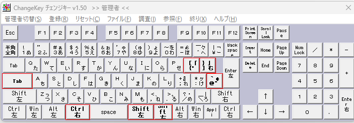

# Windows キーマップ（AutoHotkey）

Windows向けの設定と導入方法です。キーマップの考え方は、ルート README の[説明](../../README.md#キーマップの考え方)を参照してください。詳細なキー割り当ては、ルートの [キーマップページ](../../keymap.html) を参照してください。

[プロジェクト概要へ戻る](../../README.md)

## Windows の主なキーマップ設定

| キー            | 動作       |
| --------------- | ---------- |
| SL1 + H/J/K/L   | ← ↓ ↑ →    |
| SL1 + ; / :     | Home / End |
| SL2 + [ / ]     | `"` / `'` |
| SL2 + @         | 範囲指定スクリーンショット |
| SR1 + ; / :     | JIS配列の標準Shift入力 |
| SL1 + A         | 全選択     |
| SL1 + D         | Delete     |
| SL1 単押し      | Esc        |

Windows のキーマップ設定の詳細は [keymap](keymap/) ディレクトリ内のコードを直接確認してください。Windows の現行設定と macOS の設定は、ルートの[キーマップページ](../../keymap.html)で確認できます。

## セットアップ

### Change Key のセットアップ

[Change Key](https://forest.watch.impress.co.jp/library/software/changekey/) をインストールし、以下のようにキー配列を書き換えます。

※ Change Key は管理者権限で実行してください。

※ Change Key による変更後は Windows の再起動が必要です。



| 変換元                           | 変換先         |
| -------------------------------- | -------------- |
| Space の左 1(無変換キー)         | RCtrl          |
| Space の左 2(LAlt)               | LAlt(変化なし) |
| Space の右 1(変換キー)           | LShift         |
| Space の右 2(カタカナ・ひらがな) | RShift         |
| CapsLock                         | Tab            |
| Enter の上左 2(@)                | [              |
| Enter の上左 1([)                | ]              |
| Enter の下左 1(])                | @              |

### AutoHotkey のセットアップ

[AutoHotkey: 2.0.19](https://www.autohotkey.com/download/2.0/AutoHotkey_2.0.19_setup.exe) をダウンロードしてインストールしてください。

最新版をインストールしたい場合は、[AutoHotkey 公式サイト](https://www.autohotkey.com/) から AutoHotkey v2 をダウンロードしてインストールしてください。

※ バグ情報

- v2.0.24 において本スクリプトが正しく動きませんでした。
  - 症状: RCtrlを押すとEscが発動しますが、RCtrl + hjklで移動ができなくなりました。

次に本リポジトリを `git clone` します。（clone場所はお好みで変更してください。）

```
> mkdir ~/Desktop/github
> cd ~/Desktop/github
> git clone https://github.com/syunkitada/mykeymap.git
```

次に `main.ahk` を起動するショートカットを作成します。ショートカットの「リンク先」には、AutoHotkeyの実行ファイルと `main.ahk` のパスを引用符付きで指定します。

`"C:\Path\to\AutoHotkey.exe" "C:\Users\[Path...]\mykeymap\windows\autohotkey\main.ahk"`

※ ショートカット内のパスは環境に合わせて変更してください。

次に、Windows10/11 のスタートアップにショートカットを登録するため、以下の手順でショートカットディレクトリを開き、そのディレクトリにショートカットを配置します。

```
Win + R → `shell:startup`
```

ショートカットを配置したら、ダブルクリックして起動してください。

右下のタスクトレイにAutoHotkeyのアイコンが表示されていれば完了です。
